# State machines

<!-- GENERATED by `python -m scout.statemachines render --write` from
     scout/statemachines/registry.py. Do not edit by hand; a test
     fails when this file and the registry disagree. -->

The 22 lifecycles of gecko-alpha that have been written
down so far: what the states are, what each one means, which moves
happen and which function performs them. Use it to read a status you
see on the dashboard or in Telegram, and to find the code that
changes it. Lifecycles surveyed but not declared here are listed in
tasks/findings_implicit_state_machines_2026_11_19.md.

**How far to trust it.** This file always matches the registry. The
registry was written from the code and reviewed, but only part of it
is held in place by tests — each machine's *Checked by tests* line
says which part. Meanings, guards and hazards are prose: read the
function a row points at before relying on a detail.

The registry describes the app; it does not change it. To query it
from a shell or an agent:

```
python -m scout.statemachines list
python -m scout.statemachines show live_trade
python -m scout.statemachines next live_trade open
python -m scout.statemachines json
python scripts/audit_state_machines.py --db scout.db
```

| Machine | Held in | State list | Transitions |
|---|---|---|---|
| [Paper trade lifecycle](#paper-trade-lifecycle) | `paper_trades.status` | not enforced (string literals at the write sites) | guarded |
| [Exit ladder (partial take-profit legs and breakeven floor)](#exit-ladder-partial-take-profit-legs-and-breakeven-floor) | `paper_trades.leg_1_filled_at / leg_2_filled_at / floor_armed` | derived from several columns (no stored state name) | guarded |
| [Live trade ledger](#live-trade-ledger) | `live_trades.status` | SQLite CHECK constraint | declared |
| [Shadow trade ledger](#shadow-trade-ledger) | `shadow_trades.status` | SQLite CHECK constraint | declared |
| [Solana execution run](#solana-execution-run) | `solana_executions.state` | SQLite CHECK constraint | enforced |
| [EVM submission receipt](#evm-submission-receipt) | `scout.live.evm.execution.EvmReceipt.state` | Python Enum | guarded |
| [Live kill switch](#live-kill-switch) | `live_control.active_kill_event_id (+ kill_events)` | derived from several columns (no stored state name) | guarded |
| [Signal lane (enabled / suspended)](#signal-lane-enabled--suspended) | `signal_params.enabled + suspended_at` | derived from several columns (no stored state name) | declared |
| [Signal-combo suppression and parole](#signal-combo-suppression-and-parole) | `combo_performance (30-day row): suppressed + parole_at + parole_trades_remaining` | derived from several columns (no stored state name) | guarded |
| [Telegram trade-alert outcome](#telegram-trade-alert-outcome) | `tg_alert_log.outcome` | SQLite CHECK constraint | declared |
| [Operator feedback on a Telegram alert](#operator-feedback-on-a-telegram-alert) | `tg_alert_operator_actions.action` | SQLite CHECK constraint | declared |
| [Signal outcome labelling](#signal-outcome-labelling) | `signal_outcome_ledger.label_status` | SQLite CHECK constraint | guarded |
| [Source-call outcome](#source-call-outcome) | `source_calls.outcome_status` | SQLite CHECK constraint | declared |
| [Source-call token resolution](#source-call-token-resolution) | `source_calls.resolved_state` | not enforced (string literals at the write sites) | declared |
| [Robinhood/Pons curve-launch lifecycle](#robinhoodpons-curve-launch-lifecycle) | `curve_launch_discoveries.lifecycle_status` | SQLite CHECK constraint | declared |
| [Telegram message token resolution](#telegram-message-token-resolution) | `tg_social_signals.resolution_state` | Python Enum | declared |
| [Telegram listener health](#telegram-listener-health) | `tg_social_health.listener_state` | constants in one module | declared |
| [Telegram channel subscription](#telegram-channel-subscription) | `tg_social_channels.removed_at` | derived from several columns (no stored state name) | declared |
| [Narrative prediction evaluation](#narrative-prediction-evaluation) | `predictions.outcome_class` | not enforced (string literals at the write sites) | guarded |
| [Chain-match outcome](#chain-match-outcome) | `chain_matches.outcome_class` | not enforced (string literals at the write sites) | guarded |
| [Narrative alert resolution](#narrative-alert-resolution) | `narrative_alerts_inbound.resolution_status` | not enforced (string literals at the write sites) | guarded |
| [Ingestion source starvation watchdog](#ingestion-source-starvation-watchdog) | `scout.heartbeat._ingest_watchdog_state[source] (+ ingest_watchdog_state)` | not enforced (string literals at the write sites) | guarded |

## Paper trade lifecycle

`paper_trade` · held in `paper_trades.status`

One simulated position from open to close. A trade opens once and closes once; the close status records which exit rule fired.

- **State list:** not enforced (string literals at the write sites)
- **Transitions:** guarded — writes check the prior state
- **Checked by tests:** state list compared with the TradeStatus Literal and with the close-status literals in scout/trading; transitions not checked (only that each named function exists)
- **Other values in the column (not states):** `kraken_pilot_anchor`, `solana_lane_anchor`

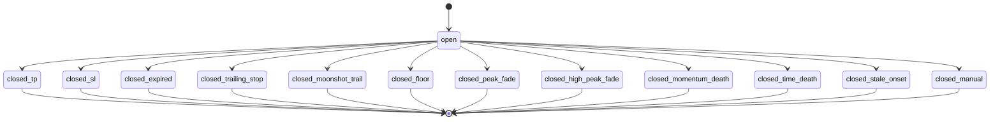

| State | Shown as | Meaning | Notes |
|---|---|---|---|
| `open` | Open | Position is held. The evaluator re-checks it on every pass. | initial |
| `closed_tp` | Closed — take profit | Reached the take-profit target. Only the pre-ladder exit rules produce it; a laddered trade scales out through its legs instead. | terminal |
| `closed_sl` | Closed — stop loss | Fell to the stop-loss before the first ladder leg filled. | terminal |
| `closed_expired` | Closed — max hold time | Held for the maximum duration. Also the status of forced closes made with no price or a stale price, so check exit_reason and exit_provenance before trusting the PnL. | terminal |
| `closed_trailing_stop` | Closed — trailing stop | Gave back the configured share of its peak gain. | terminal |
| `closed_moonshot_trail` | Closed — moonshot trail | Trailing stop fired after the moonshot threshold widened the trail. | terminal |
| `closed_floor` | Closed — breakeven floor | Fell back to entry after the first ladder leg had armed the floor. | terminal |
| `closed_peak_fade` | Closed — peak fade | Faded from its peak at both observation checkpoints. | terminal |
| `closed_high_peak_fade` | Closed — high-peak fade | Retraced from a high peak past the high-peak-fade threshold. | terminal |
| `closed_momentum_death` | Closed — momentum death | Momentum collapsed after entry. | terminal |
| `closed_time_death` | Closed — time death | Went nowhere for too long. | terminal |
| `closed_stale_onset` | Closed — price went stale | The price feed went stale; closed at the last good cached price. | terminal |
| `closed_manual` | Closed — manual | Closed by the operator. Also what a close with an unrecognised reason silently becomes. Excluded from combo win-rate statistics. | terminal |

| From | To | When | Performed by | Guard |
|---|---|---|---|---|
| (new) | `open` | a signal opens a trade | `scout/trading/paper.py::execute_buy` | creation |
| `open` | `closed_tp` | price reached take-profit (legacy exit rules) | `scout/trading/paper.py::execute_sell` | compare-and-swap in SQL |
| `open` | `closed_sl` | price fell to stop-loss | `scout/trading/paper.py::execute_sell` | compare-and-swap in SQL |
| `open` | `closed_expired` | max duration elapsed, or forced close on missing/stale price | `scout/trading/paper.py::execute_sell` | compare-and-swap in SQL |
| `open` | `closed_trailing_stop` | trailing-stop drawdown from peak | `scout/trading/paper.py::execute_sell` | compare-and-swap in SQL |
| `open` | `closed_moonshot_trail` | trailing-stop drawdown after moonshot was armed | `scout/trading/paper.py::execute_sell` | compare-and-swap in SQL |
| `open` | `closed_floor` | price returned to entry with the floor armed | `scout/trading/paper.py::execute_sell` | compare-and-swap in SQL |
| `open` | `closed_peak_fade` | peak-fade rule | `scout/trading/paper.py::execute_sell` | compare-and-swap in SQL |
| `open` | `closed_high_peak_fade` | high-peak-fade rule (when not in dry-run) | `scout/trading/paper.py::execute_sell` | compare-and-swap in SQL |
| `open` | `closed_momentum_death` | momentum-death rule (when not in dry-run) | `scout/trading/paper.py::execute_sell` | compare-and-swap in SQL |
| `open` | `closed_time_death` | time-death rule (when not in dry-run) | `scout/trading/paper.py::execute_sell` | compare-and-swap in SQL |
| `open` | `closed_stale_onset` | stale-onset exit | `scout/trading/paper.py::execute_sell` | compare-and-swap in SQL |
| `open` | `closed_manual` | operator close, or a close reason missing from status_map | `scout/trading/paper.py::execute_sell` | compare-and-swap in SQL |

Must never be true (checked by the auditor):

- **closed_without_closed_at** — A closed paper trade must carry its close time.
- **open_with_closed_at** — An open paper trade must not carry a close time.

Known hazards (read from the code at registration):

- The column has no CHECK constraint; the close statuses are spelled at the call sites in scout/trading/evaluator.py and in status_map in scout/trading/paper.py.
- execute_sell maps an unrecognised reason to closed_manual when no status_override is passed, and closed_manual is excluded from the combo statistics. The close still happens; it logs paper_close_reason_unmapped at ERROR so it does not go unnoticed.
- 'Closed' is re-derived with different predicates across modules (status != 'open', LIKE 'closed_%', LIKE 'closed%', VALID_TERMINAL_OUTCOME_SQL); they do not select the same rows.
- The two anchor values are sentinel rows inserted by the Kraken pilot and the Solana lane so their live rows have a paper parent; they are not trades.

## Exit ladder (partial take-profit legs and breakeven floor)

`exit_ladder` · held in `paper_trades.leg_1_filled_at / leg_2_filled_at / floor_armed`

How far a trade has scaled out, for open and closed trades alike. Filling leg 1 arms the breakeven floor, which replaces the stop-loss from then on.

- **State list:** derived from several columns (no stored state name)
- **Transitions:** guarded — writes check the prior state
- **Checked by tests:** state list not checked against the code; transitions not checked (only that each named function exists)
- **Rows it covers:** `status NOT IN ('kraken_pilot_anchor', 'solana_lane_anchor')`

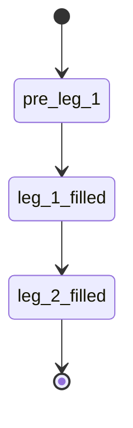

| State | Shown as | Meaning | Notes |
|---|---|---|---|
| `legacy` | No ladder | Opened before the ladder cut-over (no remaining_qty); handled by the legacy exit rules. | terminal, never written by code |
| `pre_leg_1` | No leg filled | No ladder leg has filled. While such a trade is open the stop-loss is its downside exit. | initial |
| `leg_1_filled` | Leg 1 filled, floor armed | First partial taken and the breakeven floor armed. The stop-loss no longer applies. From here on the floor exit, the trailing (or moonshot) stop, the fade and momentum-death rules, max hold time, a forced close on a stale or missing price, and a manual close can all close it (time-death only applies before leg 1). |  |
| `leg_2_filled` | Leg 2 filled | Both partials taken; the remainder rides the trailing stop. | terminal |

| From | To | When | Performed by | Guard |
|---|---|---|---|---|
| (new) | `pre_leg_1` | trade opened | `scout/trading/paper.py::execute_buy` | creation |
| `pre_leg_1` | `leg_1_filled` | gain reached the leg-1 threshold | `scout/trading/paper.py::execute_partial_sell` | compare-and-swap in SQL |
| `leg_1_filled` | `leg_2_filled` | gain reached the leg-2 threshold | `scout/trading/paper.py::execute_partial_sell` | compare-and-swap in SQL |

How each state is recognised in the table:

- `legacy`: `remaining_qty IS NULL`
- `pre_leg_1`: `remaining_qty IS NOT NULL AND leg_1_filled_at IS NULL AND leg_2_filled_at IS NULL AND COALESCE(floor_armed, 0) = 0`
- `leg_1_filled`: `remaining_qty IS NOT NULL AND leg_1_filled_at IS NOT NULL AND leg_2_filled_at IS NULL AND COALESCE(floor_armed, 0) = 1`
- `leg_2_filled`: `remaining_qty IS NOT NULL AND leg_1_filled_at IS NOT NULL AND leg_2_filled_at IS NOT NULL AND COALESCE(floor_armed, 0) = 1`

Known hazards (read from the code at registration):

- execute_partial_sell guards on the leg column being NULL but not on status = 'open', and it accepts either leg; the order (leg 1 before leg 2) is enforced only by the caller in evaluate_paper_trades.
- A row matching none of the four predicates (for example floor armed with leg 1 empty) is representable and is what the auditor reports.
- The anchor sentinel rows are out of scope: they have no remaining_qty and would otherwise be counted as legacy trades.

## Live trade ledger

`live_trade` · held in `live_trades.status`

The money ledger for real orders on every venue (Binance engine, Kraken pilot, Solana lane). One row per order intent.

- **State list:** SQLite CHECK constraint
- **Transitions:** declared here only — nothing checks at runtime
- **Checked by tests:** state list compared with the CHECK constraint; transitions not checked (only that each named function exists)

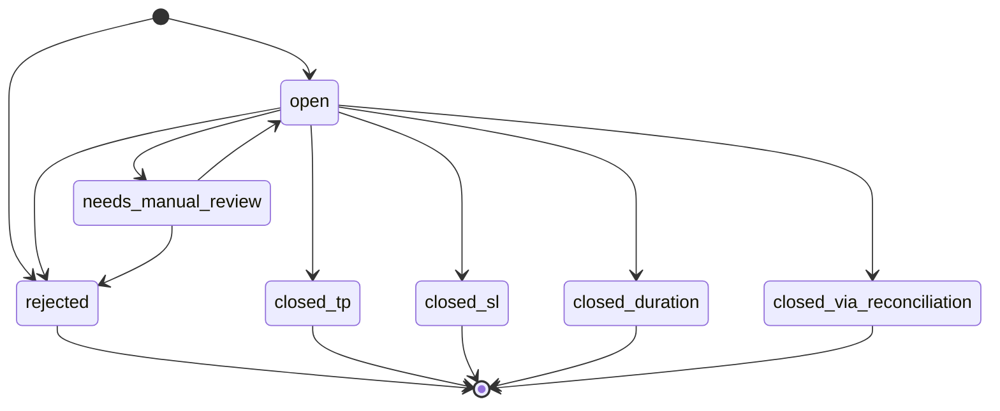

| State | Shown as | Meaning | Notes |
|---|---|---|---|
| `open` | Open | An order intent is on record: about to be submitted, resting, or filled and held. The Solana lane records it before the authorization prompt, so 'open' does not by itself mean anything was sent. | initial |
| `rejected` | Rejected | No position resulted: refused before submission, definitively refused by Kraken, proved never submitted or failed on chain (Solana), or cancelled with nothing filled. On the Binance engine a venue-rejected buy becomes needs_manual_review, not this. | initial, terminal |
| `closed_tp` | Closed — take profit | Exit filled at take-profit. | terminal |
| `closed_sl` | Closed — stop loss | Exit filled at stop-loss. | terminal |
| `closed_duration` | Closed — max hold time | Exit filled after the maximum hold time. | terminal |
| `closed_via_reconciliation` | Closed — by reconciliation | A supervised Kraken exit or a Solana reverse swap was reconciled and the position is gone. | terminal |
| `needs_manual_review` | Needs manual review | Automation could not establish what happened on the venue. Check the venue account and the evidence file. Apart from the Solana lane's own paths and the Kraken cancel command, nothing in the code moves a row out of this state: it is settled by hand. | needs attention |

| From | To | When | Performed by | Guard |
|---|---|---|---|---|
| (new) | `rejected` | refused before submission (mandate, routing, gate) | `scout/live/engine.py::_write_live_reject` | creation |
| (new) | `open` | recorded just before the venue submit (Binance, Kraken) | `scout/live/idempotency.py::record_pending_order` | creation |
| (new) | `open` | recorded before the authorization prompt (Solana) | `scout/live/solana_lane.py::record_solana_intent` | creation |
| `open` | `closed_tp` | exit level crossed and the sell filled | `scout/live/live_evaluator.py::_close_live_trade` | none |
| `open` | `closed_sl` | exit level crossed and the sell filled | `scout/live/live_evaluator.py::_close_live_trade` | none |
| `open` | `closed_duration` | exit level crossed and the sell filled | `scout/live/live_evaluator.py::_close_live_trade` | none |
| `open` | `closed_via_reconciliation` | supervised Kraken exit reconciled | `scout/live/kraken_pilot.py::_reconcile_and_close` | none |
| `open` | `closed_via_reconciliation` | Solana reverse swap reconciled | `scout/live/solana_lane.py::_close_reverse_row` | none |
| `open` | `needs_manual_review` | entry ended without a clean fill (partial, rejected or timed out) | `scout/live/engine.py::_dispatch_live` | compare-and-swap in SQL |
| `open` | `needs_manual_review` | exit sell did not fill | `scout/live/live_evaluator.py::_mark_exit_needs_review` | compare-and-swap in SQL |
| `open` | `needs_manual_review` | boot reconciliation could not match the venue | `scout/live/reconciliation.py::_flag_live_review` | compare-and-swap in SQL |
| `open` | `needs_manual_review` | Kraken submission could not be resolved | `scout/live/kraken_pilot.py::_resolve_ambiguity` | none |
| `open` | `needs_manual_review` | Kraken exit submission could not be resolved | `scout/live/kraken_pilot.py::_resolve_exit_ambiguity` | none |
| `open` | `needs_manual_review` | Kraken exit order ended with an unreadable or zero fill | `scout/live/kraken_pilot.py::_settle_exit_outcome` | none |
| `open` | `needs_manual_review` | a Kraken partial exit fill was already applied once | `scout/live/kraken_pilot.py::_record_partial_exit` | none |
| `open` | `needs_manual_review` | Kraken exit reconciliation did not match | `scout/live/kraken_pilot.py::_reconcile_and_close` | none |
| `open` | `needs_manual_review` | Solana submission outcome unknown | `scout/live/solana_lane.py::_handle_ambiguity` | none |
| `open` | `needs_manual_review` | Solana reverse submission outcome unknown | `scout/live/solana_lane.py::_handle_reverse_ambiguity` | none |
| `open` | `rejected` | kill switch found active on the re-check after approval | `scout/live/kraken_pilot.py::place` | none |
| `open` | `rejected` | Kraken definitively refused the order | `scout/live/kraken_pilot.py::_submit_and_resolve` | none |
| `open` | `rejected` | resolution proved Kraken never accepted the order | `scout/live/kraken_pilot.py::_resolve_ambiguity` | none |
| `open` | `rejected` | Kraken order ended with nothing filled | `scout/live/kraken_pilot.py::_await_and_reconcile` | none |
| `open` | `rejected` | operator cancel with nothing filled | `scout/live/kraken_pilot.py::cancel` | compare-and-swap in SQL |
| `needs_manual_review` | `rejected` | operator cancel with nothing filled | `scout/live/kraken_pilot.py::cancel` | compare-and-swap in SQL |
| `open` | `rejected` | Solana run proved never submitted, or failed on chain | `scout/live/solana_lane.py::retire_row` | none |
| `needs_manual_review` | `rejected` | Solana run proved never submitted, or failed on chain | `scout/live/solana_lane.py::retire_row` | none |
| `needs_manual_review` | `open` | reverse swap proved not submitted; the position is still held | `scout/live/solana_lane.py::_apply_reverse_verdict` | check in Python before the write |

Must never be true (checked by the auditor):

- **closed_without_closed_at** — A closed live trade must carry its close time. Every code path sets it; a row settled by hand without closed_at shows up here.
- **open_with_closed_at** — An open live trade must not carry a close time.

Known hazards (read from the code at registration):

- Most writes are UPDATE ... WHERE id = ? with no check of the prior status in the statement or the function; where a check exists it is usually in the caller. Only the transitions marked compare-and-swap filter on the prior status in the SQL itself.
- KrakenPilot.cancel always sends the venue cancel, whatever the row's status, because that reduces exposure. Its ledger write applies only while the row is open or needs_manual_review, no exit is recorded and, for the write of rejected, the ledger records no entry fill; otherwise the row is left as it was and the evidence records cancel_ledger_unchanged. When the ledger and the venue disagree about a fill, cancel exits for review.
- Manual settlement of needs_manual_review rows is done with SQL outside the code, so those moves cannot appear in this table.
- needs_manual_review means different things per venue: the Binance engine uses it so a row stops counting as open exposure, while the Kraken pilot and the Solana lane treat it as blocking the lane.
- 'Closed' is re-derived three ways: LIKE 'closed_%' (scout/live/kill_switch.py), LIKE 'closed%' (scout/live/services/dormancy.py, approval_thresholds.py) and an explicit tuple (scout/live/mandate.py).

## Shadow trade ledger

`shadow_trade` · held in `shadow_trades.status`

What the live engine would have done, recorded without sending an order. It reuses the live ledger's status names; the meanings are its own.

- **State list:** SQLite CHECK constraint
- **Transitions:** declared here only — nothing checks at runtime
- **Checked by tests:** state list compared with the CHECK constraint; transitions not checked (only that each named function exists)

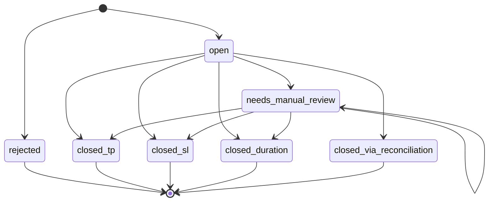

| State | Shown as | Meaning | Notes |
|---|---|---|---|
| `open` | Open (simulated) | A simulated position: the engine would have entered here. No order was sent. | initial |
| `rejected` | Not entered | A pre-trade gate refused the entry, or order-book depth could not be fetched. | initial, terminal |
| `closed_tp` | Closed — take profit (simulated) | Take-profit level crossed; exit simulated against the order book. | terminal |
| `closed_sl` | Closed — stop loss (simulated) | Stop-loss level crossed; exit simulated against the order book. | terminal |
| `closed_duration` | Closed — max hold time (simulated) | Maximum hold time reached; exit simulated against the order book. | terminal |
| `closed_via_reconciliation` | Closed — at boot | An exit level was found already crossed when checked at boot. | terminal |
| `needs_manual_review` | Review backoff | Could not be evaluated (price or exit depth unavailable) three times over the row's life. It is picked up again once its next_review_at has passed and closes normally if a level is then crossed, so unlike the live ledger this is not a dead end. |  |

| From | To | When | Performed by | Guard |
|---|---|---|---|---|
| (new) | `rejected` | the live engine processes a paper-trade open | `scout/live/engine.py::on_paper_trade_opened` | creation |
| (new) | `open` | the live engine processes a paper-trade open | `scout/live/engine.py::on_paper_trade_opened` | creation |
| `open` | `closed_tp` | exit level crossed | `scout/live/shadow_evaluator.py::_close_shadow_trade` | none |
| `open` | `closed_sl` | exit level crossed | `scout/live/shadow_evaluator.py::_close_shadow_trade` | none |
| `open` | `closed_duration` | exit level crossed | `scout/live/shadow_evaluator.py::_close_shadow_trade` | none |
| `needs_manual_review` | `closed_tp` | exit level crossed | `scout/live/shadow_evaluator.py::_close_shadow_trade` | none |
| `needs_manual_review` | `closed_sl` | exit level crossed | `scout/live/shadow_evaluator.py::_close_shadow_trade` | none |
| `needs_manual_review` | `closed_duration` | exit level crossed | `scout/live/shadow_evaluator.py::_close_shadow_trade` | none |
| `open` | `closed_via_reconciliation` | exit level found already crossed at boot | `scout/live/reconciliation.py::_close_crossed_row` | none |
| `open` | `needs_manual_review` | third evaluation failure (review_retries is never reset) | `scout/live/shadow_evaluator.py::_bump_review` | none |
| `needs_manual_review` | `needs_manual_review` | re-evaluation failed again; next_review_at is pushed out | `scout/live/shadow_evaluator.py::_bump_review` | none |

Known hazards (read from the code at registration):

- Every UPDATE is WHERE id = ? with no check of the prior status.
- Gate-refused and depth-failure rows are written before the engine branches on mode, so they appear here in live mode as well.

## Solana execution run

`solana_execution` · held in `solana_executions.state`

One swap attempt on the Solana lane, from quote to reconciled balances. This is the reference implementation: the lane declares its own transition table and refuses any write that is not in it. The registry mirrors that table and a test keeps the two equal.

- **State list:** SQLite CHECK constraint
- **Transitions:** enforced — an illegal move raises
- **Checked by tests:** state list compared with the CHECK constraint; transitions compared with the lane's own table

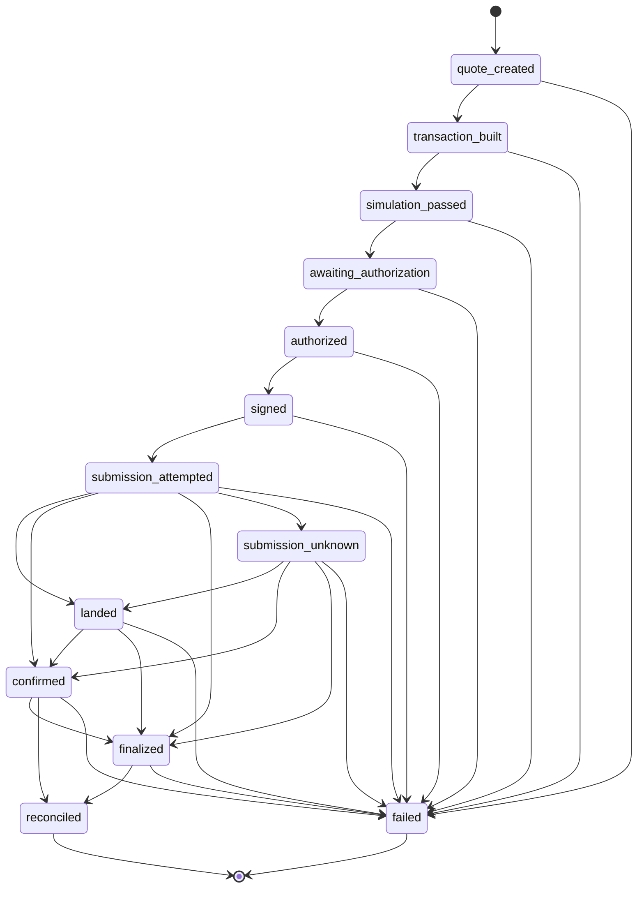

| State | Shown as | Meaning | Notes |
|---|---|---|---|
| `quote_created` | Quote created | A quote was fetched. | initial |
| `transaction_built` | Transaction built | The swap transaction was built. |  |
| `simulation_passed` | Simulation passed | The exact transaction simulated cleanly. |  |
| `awaiting_authorization` | Awaiting authorization | Waiting for the operator (or the mandate) to approve. | needs attention |
| `authorized` | Authorized | Approved; not yet signed. |  |
| `signed` | Signed | Signed locally; nothing has been sent. |  |
| `submission_attempted` | Submission attempted | A send was attempted, so a transaction may exist. The lane is blocked until the cluster says what happened. |  |
| `landed` | Landed | The cluster has seen the transaction. |  |
| `confirmed` | Confirmed | Confirmed by the cluster. Permitted by the table; no code path writes it today. | never written by code |
| `finalized` | Finalized | Finalized by the cluster. |  |
| `submission_unknown` | Submission unknown | The send's outcome could not be determined. Run the lane's resolve command; do not rebuild or resubmit. | needs attention |
| `reconciled` | Reconciled | Balances were checked against the swap and explained. | terminal |
| `failed` | Failed | The run is over. On a forward run no position exists. On a reverse (exit) run the position is still held and its ledger row stays open. | terminal |

| From | To | When | Performed by | Guard |
|---|---|---|---|---|
| (new) | `quote_created` | run starts | `scout/live/solana_lane.py::record_execution_state` | transition table |
| `quote_created` | `transaction_built` | build | `scout/live/solana_lane.py::record_execution_state` | transition table |
| `quote_created` | `failed` | build | `scout/live/solana_lane.py::record_execution_state` | transition table |
| `transaction_built` | `simulation_passed` | simulate | `scout/live/solana_lane.py::record_execution_state` | transition table |
| `transaction_built` | `failed` | simulate | `scout/live/solana_lane.py::record_execution_state` | transition table |
| `simulation_passed` | `awaiting_authorization` | request approval | `scout/live/solana_lane.py::record_execution_state` | transition table |
| `simulation_passed` | `failed` | request approval | `scout/live/solana_lane.py::record_execution_state` | transition table |
| `awaiting_authorization` | `authorized` | approval decision | `scout/live/solana_lane.py::record_execution_state` | transition table |
| `awaiting_authorization` | `failed` | approval decision | `scout/live/solana_lane.py::record_execution_state` | transition table |
| `authorized` | `signed` | sign | `scout/live/solana_lane.py::record_execution_state` | transition table |
| `authorized` | `failed` | sign | `scout/live/solana_lane.py::record_execution_state` | transition table |
| `signed` | `submission_attempted` | submit | `scout/live/solana_lane.py::record_execution_state` | transition table |
| `signed` | `failed` | submit | `scout/live/solana_lane.py::record_execution_state` | transition table |
| `submission_attempted` | `landed` | what the cluster reports | `scout/live/solana_lane.py::record_execution_state` | transition table |
| `submission_attempted` | `confirmed` | what the cluster reports | `scout/live/solana_lane.py::record_execution_state` | transition table |
| `submission_attempted` | `finalized` | what the cluster reports | `scout/live/solana_lane.py::record_execution_state` | transition table |
| `submission_attempted` | `submission_unknown` | what the cluster reports | `scout/live/solana_lane.py::record_execution_state` | transition table |
| `submission_attempted` | `failed` | what the cluster reports | `scout/live/solana_lane.py::record_execution_state` | transition table |
| `landed` | `confirmed` | what the cluster reports | `scout/live/solana_lane.py::record_execution_state` | transition table |
| `landed` | `finalized` | what the cluster reports | `scout/live/solana_lane.py::record_execution_state` | transition table |
| `landed` | `failed` | what the cluster reports | `scout/live/solana_lane.py::record_execution_state` | transition table |
| `confirmed` | `finalized` | finality / reconciliation | `scout/live/solana_lane.py::record_execution_state` | transition table |
| `confirmed` | `reconciled` | finality / reconciliation | `scout/live/solana_lane.py::record_execution_state` | transition table |
| `confirmed` | `failed` | finality / reconciliation | `scout/live/solana_lane.py::record_execution_state` | transition table |
| `finalized` | `reconciled` | reconciliation | `scout/live/solana_lane.py::record_execution_state` | transition table |
| `finalized` | `failed` | reconciliation | `scout/live/solana_lane.py::record_execution_state` | transition table |
| `submission_unknown` | `landed` | resolver verdict | `scout/live/solana_lane.py::record_execution_state` | transition table |
| `submission_unknown` | `confirmed` | resolver verdict | `scout/live/solana_lane.py::record_execution_state` | transition table |
| `submission_unknown` | `finalized` | resolver verdict | `scout/live/solana_lane.py::record_execution_state` | transition table |
| `submission_unknown` | `failed` | resolver verdict | `scout/live/solana_lane.py::record_execution_state` | transition table |

Known hazards (read from the code at registration):

- The guard reads the current state and then writes; the read is not part of the same SQL statement as the write.
- When the confirmation poll times out and the resolver then adopts the transaction as landed, both paths first record the catch-up state (finalized or landed). An adoption that is not finalized is a reconciliation mismatch: the run stops at landed for review.
- record_execution_state replaces the stored detail JSON whenever a detail is passed; callers that need to keep earlier keys must merge them first.

## EVM submission receipt

`evm_execution` · held in `scout.live.evm.execution.EvmReceipt.state`

The submission state of one 0x AllowanceHolder transaction. Not used in production: no production code constructs a receipt, and the only wired broadcaster is the disabled one.

- **State list:** Python Enum
- **Transitions:** guarded — writes check the prior state
- **Checked by tests:** state list compared with the ExecutionState Enum; transitions not checked (only that each named function exists)

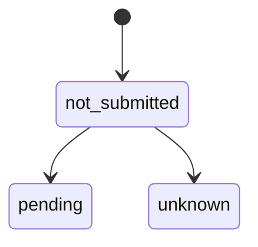

| State | Shown as | Meaning | Notes |
|---|---|---|---|
| `not_submitted` | Not submitted | Nothing was sent; rebuilding is safe. | initial |
| `pending` | Pending | Sent; awaiting inclusion. |  |
| `unknown` | Unknown | The send raised ambiguously. Rebuilding is forbidden: a transaction may exist. | needs attention |
| `confirmed` | Confirmed | Included in a block. | never written by code |
| `finalized` | Finalized | Final. | terminal, never written by code |
| `reverted` | Reverted | Executed and reverted. | terminal, never written by code |
| `replaced` | Replaced | Replaced by another transaction with the same nonce. | needs attention, never written by code |

| From | To | When | Performed by | Guard |
|---|---|---|---|---|
| (new) | `not_submitted` | a caller constructs the receipt (only tests do today) | `scout/live/evm/execution.py::EvmReceipt` | creation |
| `not_submitted` | `pending` | broadcast succeeded / raised ambiguously | `scout/live/evm/execution.py::submit_once` | check in Python before the write |
| `not_submitted` | `unknown` | broadcast succeeded / raised ambiguously | `scout/live/evm/execution.py::submit_once` | check in Python before the write |

Known hazards (read from the code at registration):

- There is no transition table; the only guard is submit_once refusing anything that is not not_submitted.
- confirmed, finalized, reverted and replaced can only come from a Broadcaster.lookup implementation, and none is wired, so pending and unknown have nowhere to go.
- EvmReceipt.is_terminal counts not_submitted as terminal; the registry does not, because submit_once moves it on.

## Live kill switch

`kill_switch` · held in `live_control.active_kill_event_id (+ kill_events)`

Whether live order placement is halted. Engaged by the daily loss cap, by the engine on a Binance auth or IP-ban failure, or by the operator; it stops halting orders when killed_until passes and is released when cleared.

- **State list:** derived from several columns (no stored state name)
- **Transitions:** guarded — writes check the prior state
- **Checked by tests:** state list not checked against the code; transitions not checked (only that each named function exists)

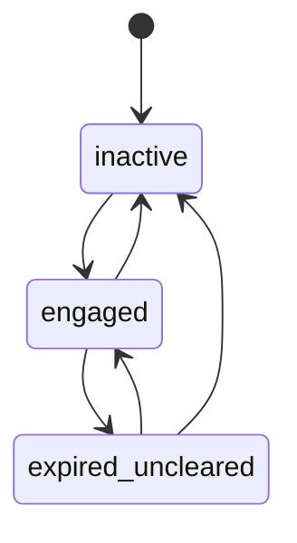

| State | Shown as | Meaning | Notes |
|---|---|---|---|
| `inactive` | Inactive | Live orders are allowed. | initial |
| `engaged` | Engaged | Live orders are halted until killed_until. | needs attention |
| `expired_uncleared` | Expired, not yet cleared | killed_until has passed, so orders are allowed again, but the pointer is still set. The per-tick auto-clear normally removes this at once, and a new kill releases it itself. If it lingers, the auto-clear tick is not running. | needs attention |

| From | To | When | Performed by | Guard |
|---|---|---|---|---|
| (new) | `inactive` | schema installed | `scout/db.py::_migrate_live_trading_schema` | creation |
| `inactive` | `engaged` | daily loss cap tripped, automatic engine kill, or operator kill | `scout/live/kill_switch.py::trigger` | compare-and-swap in SQL |
| `expired_uncleared` | `engaged` | a new kill arrives; the expired event is stamped cleared and the pointer re-claimed in one transaction | `scout/live/kill_switch.py::trigger` | re-read and written in one locked transaction |
| `engaged` | `expired_uncleared` | killed_until passes (no write: is_active starts answering inactive) | `scout/live/kill_switch.py::is_active` | none |
| `engaged` | `inactive` | operator clear | `scout/live/kill_switch.py::clear` | none |
| `expired_uncleared` | `inactive` | operator clear | `scout/live/kill_switch.py::clear` | none |
| `expired_uncleared` | `inactive` | automatic clear on the next tick or at boot | `scout/live/kill_switch.py::auto_clear_if_expired` | compare-and-swap in SQL |
| `expired_uncleared` | `inactive` | the clear-expired-kills script (its caller checks the expiry first) | `scripts/clear_expired_kills.py::_apply_clear` | compare-and-swap in SQL |

How each state is recognised in the table:

- `inactive`: `active_kill_event_id IS NULL`
- `engaged`: `active_kill_event_id IS NOT NULL AND EXISTS (SELECT 1 FROM kill_events k WHERE k.id = live_control.active_kill_event_id AND k.cleared_at IS NULL AND julianday(k.killed_until) >= julianday('now'))`
- `expired_uncleared`: `active_kill_event_id IS NOT NULL AND EXISTS (SELECT 1 FROM kill_events k WHERE k.id = live_control.active_kill_event_id AND k.cleared_at IS NULL AND julianday(k.killed_until) < julianday('now'))`

Known hazards (read from the code at registration):

- trigger is a real compare-and-swap on the pointer. The operator's clear releases whichever kill is active when it runs. The automatic clears (auto_clear_if_expired and the clear-expired-kills script) apply only while the pointer still names the event they judged expired.
- Before claiming, trigger releases a pointer whose event is expired, already cleared or missing, so a dead pointer does not block a new kill. A kill still in force wins the compare-and-swap as before.
- A pointer left on an already-cleared event matches no state: the switch reads as inactive. No automatic clear releases it; the next trigger does, and so does an operator clear. The auditor reports that row.

## Signal lane (enabled / suspended)

`signal_lane` · held in `signal_params.enabled + suspended_at`

Whether a signal type may open paper trades. Auto-suspend turns a losing lane off; only the operator turns it back on.

- **State list:** derived from several columns (no stored state name)
- **Transitions:** declared here only — nothing checks at runtime
- **Checked by tests:** state list compared with dashboard/lane_status.py and dashboard/frontend/signalLaneStatus.js; transitions not checked (only that each named function exists)

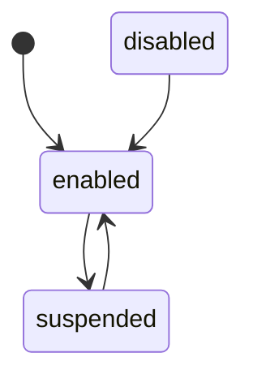

| State | Shown as | Meaning | Notes |
|---|---|---|---|
| `enabled` | Enabled | The lane opens trades. | initial |
| `disabled` | Disabled | Turned off by the operator (no suspension record). | never written by code |
| `suspended` | Suspended | Turned off automatically after losses; suspended_reason says which rule fired. Revive it with the revival runbook. | needs attention |

| From | To | When | Performed by | Guard |
|---|---|---|---|---|
| (new) | `enabled` | lane seeded | `scout/db.py::_migrate_signal_params_schema` | creation |
| `enabled` | `suspended` | hard-loss or PnL-threshold rule (the caller selected enabled lanes) | `scout/trading/auto_suspend.py::_suspend` | none |
| `suspended` | `enabled` | operator revive | `scout/db.py::revive_signal_with_baseline` | none |
| `disabled` | `enabled` | operator revive | `scout/db.py::revive_signal_with_baseline` | none |

How each state is recognised in the table:

- `enabled`: `enabled = 1 AND suspended_at IS NULL`
- `disabled`: `enabled = 0 AND suspended_at IS NULL`
- `suspended`: `enabled = 0 AND suspended_at IS NOT NULL`

Known hazards (read from the code at registration):

- No code writes 'disabled'; it only arises from operator SQL.
- revive_signal_with_baseline does not require the lane to be off, so reviving an enabled lane re-stamps its drawdown baseline and re-paroles its combo.
- scout/trading/params.py answers enabled=True without reading the row when the params table is switched off, the database is closed or the row is missing. For a signal type that is not a known default, params_for_signal also answers enabled=True while get_params raises UnknownSignalType. Table reads and the missing-row answer are cached per process for five minutes, or until bump_cache_version is called.
- _suspend itself is UPDATE ... WHERE signal_type = ? with no check that the lane is still enabled; that filter is the caller's earlier SELECT.
- dashboard/lane_status.py derives these three states plus 'unknown'. A row with enabled = 0 and an unreadable or future-dated suspended_at is suspended here and unknown there. SignalTrustTab.jsx shows SUSPENDED for both disabled and suspended.
- enabled = 1 with suspended_at set matches no state; the dashboard calls it conflicting_suspension_metadata and the auditor reports it.

## Signal-combo suppression and parole

`combo_suppression` · held in `combo_performance (30-day row): suppressed + parole_at + parole_trades_remaining`

A signal combination with a poor 30-day win rate is suppressed, then allowed a limited number of retest trades (parole) to earn its way back.

- **State list:** derived from several columns (no stored state name)
- **Transitions:** guarded — writes check the prior state
- **Checked by tests:** state list not checked against the code; transitions not checked (only that each named function exists)
- **Rows it covers:** `window = '30d'`

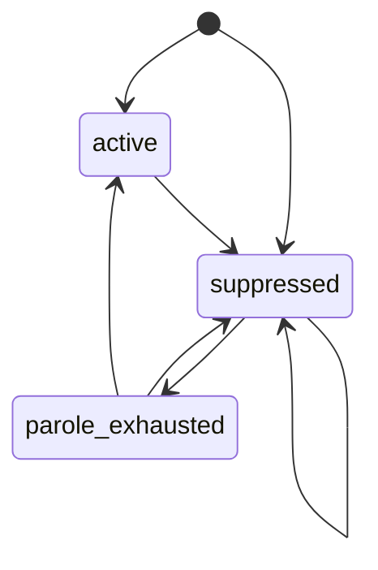

| State | Shown as | Meaning | Notes |
|---|---|---|---|
| `active` | Not suppressed | Trades on this combination are admitted normally. | initial |
| `suppressed` | Suppressed, parole slots left | Blocked until parole_at; after that each admitted retest trade spends one parole slot. | initial |
| `parole_exhausted` | Suppressed, parole spent | All retest slots are used. Normally the nightly refresh then judges the retest; a generation whose retest can never complete stays here until the operator acts. |  |

| From | To | When | Performed by | Guard |
|---|---|---|---|---|
| (new) | `active` | first nightly refresh | `scout/trading/combo_refresh.py::_refresh_combo_locked` | creation |
| (new) | `suppressed` | first nightly refresh | `scout/trading/combo_refresh.py::_refresh_combo_locked` | creation |
| `active` | `suppressed` | 30-day win rate below threshold | `scout/trading/combo_refresh.py::_refresh_combo_locked` | re-read and written in one locked transaction |
| `suppressed` | `parole_exhausted` | last parole slot spent | `scout/trading/suppression.py::_open_gate` | re-read and written in one locked transaction |
| `parole_exhausted` | `suppressed` | a reserved slot was refunded | `scout/trading/suppression.py::_refund_parole_slot` | compare-and-swap in SQL |
| `parole_exhausted` | `suppressed` | retest failed; a fresh suppression generation starts | `scout/trading/combo_refresh.py::_refresh_combo_locked` | re-read and written in one locked transaction |
| `parole_exhausted` | `suppressed` | operator revive re-opens parole | `scout/db.py::revive_signal_with_baseline` | compare-and-swap in SQL |
| `suppressed` | `suppressed` | operator revive restarts parole from now, ending any lock early | `scout/db.py::revive_signal_with_baseline` | compare-and-swap in SQL |
| `parole_exhausted` | `active` | retest passed | `scout/trading/combo_refresh.py::_refresh_combo_locked` | re-read and written in one locked transaction |

How each state is recognised in the table:

- `active`: `suppressed = 0`
- `suppressed`: `suppressed = 1 AND parole_at IS NOT NULL AND COALESCE(parole_trades_remaining, 0) > 0`
- `parole_exhausted`: `suppressed = 1 AND parole_at IS NOT NULL AND COALESCE(parole_trades_remaining, 0) <= 0`

Known hazards (read from the code at registration):

- Only the 30-day row is the entity. 7-day rows share the columns and are always written suppressed = 0, so they are out of scope.
- suppressed = 1 with parole_at NULL matches no state: the gate denies it and the retest pager skips it until an operator revive gives it a parole date. The auditor reports such rows.
- An unparsable parole_at makes the gate admit the trade (db_error_fallback_allow) without spending a slot.
- parole_trades_remaining = NULL on a suppressed row is read as exhausted by the gate, as not exhausted by the refresh classifier and as 1 by the retest pager. No current writer produces it.

## Telegram trade-alert outcome

`tg_alert_outcome` · held in `tg_alert_log.outcome`

What happened to one attempt to alert about a trade or detection. Rows are written once; the only later change is sent -> dispatch_failed when a send fails after the row was written.

- **State list:** SQLite CHECK constraint
- **Transitions:** declared here only — nothing checks at runtime
- **Checked by tests:** state list compared with the CHECK constraint; state list also compared with dashboard/telegram_outcomes.py and TelegramOutcomePanel.jsx; transitions not checked (only that each named function exists)

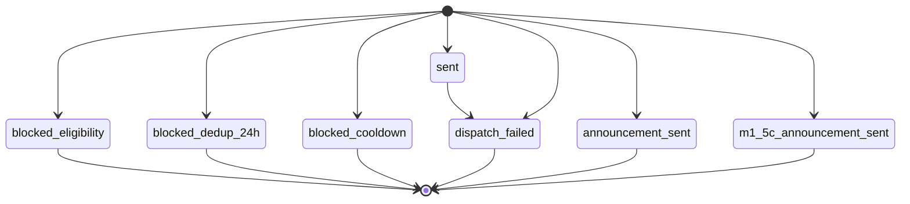

| State | Shown as | Meaning | Notes |
|---|---|---|---|
| `sent` | Sent | Delivered — except on the paper-trade lane, where the row is committed before the send and means 'claimed'. | initial |
| `blocked_eligibility` | Blocked — not eligible | The signal or token is not eligible for Telegram alerts. | initial, terminal |
| `blocked_dedup_24h` | Blocked — already alerted | The token was alerted within the dedup window. | initial, terminal |
| `blocked_cooldown` | Blocked — cooldown | Written today only by the detection lane, where it also means the token was alerted within the last 24 hours. | initial, terminal |
| `dispatch_failed` | Dispatch failed | The Telegram send failed or was cancelled. | initial, terminal |
| `announcement_sent` | Announcement sent | One-time marker: the alerts-enabled announcement went out. | initial, terminal |
| `m1_5c_announcement_sent` | M1.5c announcement sent | One-time marker for the M1.5c announcement. | initial, terminal |

| From | To | When | Performed by | Guard |
|---|---|---|---|---|
| (new) | `sent` | paper trade opened | `scout/trading/tg_alert_dispatch.py::notify_paper_trade_opened` | creation |
| (new) | `blocked_eligibility` | paper trade opened | `scout/trading/tg_alert_dispatch.py::notify_paper_trade_opened` | creation |
| (new) | `blocked_dedup_24h` | paper trade opened | `scout/trading/tg_alert_dispatch.py::notify_paper_trade_opened` | creation |
| (new) | `sent` | trade surfaced (the sent row is meant to be committed after the send) | `scout/trading/trade_surface_alerts.py::_send_claimed_alert` | creation |
| (new) | `blocked_dedup_24h` | trade surfaced (the sent row is meant to be committed after the send) | `scout/trading/trade_surface_alerts.py::_send_claimed_alert` | creation |
| `sent` | `dispatch_failed` | the send failed or was cancelled; normally inside the still uncommitted transaction, so readers see only dispatch_failed | `scout/trading/trade_surface_alerts.py::_send_claimed_alert` | none |
| (new) | `sent` | early detection | `scout/trading/detection_alert.py::notify_early_detections` | creation |
| (new) | `blocked_eligibility` | early detection | `scout/trading/detection_alert.py::notify_early_detections` | creation |
| (new) | `blocked_cooldown` | early detection | `scout/trading/detection_alert.py::notify_early_detections` | creation |
| (new) | `dispatch_failed` | early detection | `scout/trading/detection_alert.py::notify_early_detections` | creation |
| (new) | `announcement_sent` | first boot with alerts enabled | `scout/main.py::_maybe_announce_tg_alerts` | creation |
| (new) | `m1_5c_announcement_sent` | first boot after M1.5c | `scout/main.py::_maybe_announce_m1_5c` | creation |
| `sent` | `dispatch_failed` | the send failed after the row was claimed | `scout/trading/tg_alert_dispatch.py::notify_paper_trade_opened` | none |
| `sent` | `dispatch_failed` | the send was cancelled after the row was claimed | `scout/trading/tg_alert_dispatch.py::_demote_sent_row` | none |

Known hazards (read from the code at registration):

- sent is committed before the send on the paper-trade lane, so a crash in between leaves a sent row for an alert that never went out and blocks that token for the dedup window.
- The detection lane records its 24-hour dedup as blocked_cooldown while the other lanes use blocked_dedup_24h, so counts of either value alone understate deduplication.
- The demotion UPDATEs are WHERE id = ? without AND outcome = 'sent'.
- The surface lane inserts its sent row uncommitted and awaits the Telegram call holding only the transaction lock. Other writers on the shared connection commit without that lock, so one of them can make the provisional sent row durable before the send finishes.
- Both announcement helpers call send_telegram_message without raise_on_failure, so the marker row is written even when Telegram rejects the message.

## Operator feedback on a Telegram alert

`operator_action` · held in `tg_alert_operator_actions.action`

The operator's latest label for a sent alert; may be relabelled freely.

- **State list:** SQLite CHECK constraint
- **Transitions:** declared here only — nothing checks at runtime
- **Checked by tests:** state list compared with the CHECK constraint; transitions not checked (only that each named function exists)

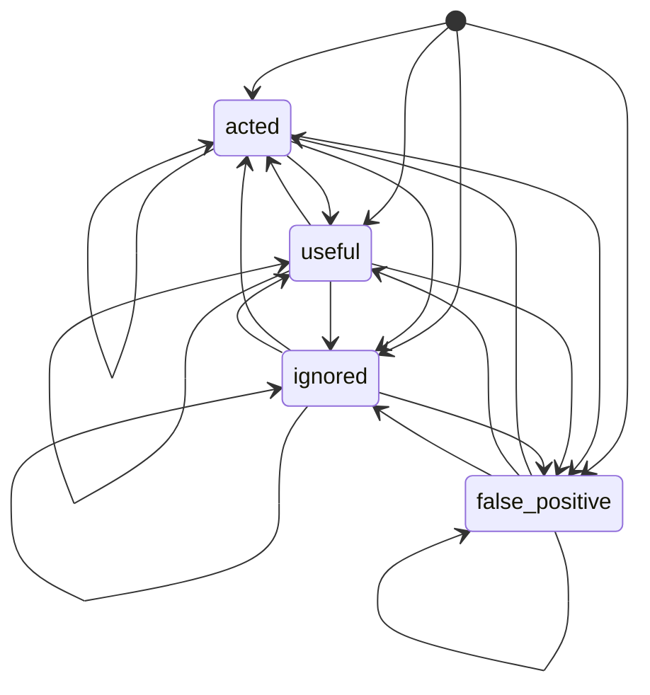

| State | Shown as | Meaning | Notes |
|---|---|---|---|
| `acted` | Acted | The operator traded on the alert. | initial |
| `useful` | Useful | Informative, not traded. | initial |
| `ignored` | Ignored | Seen and passed over. | initial |
| `false_positive` | False positive | The alert was wrong. | initial |

| From | To | When | Performed by | Guard |
|---|---|---|---|---|
| (new) | `acted` | operator labels the alert | `scout/db.py::record_tg_alert_operator_action` | creation |
| (new) | `useful` | operator labels the alert | `scout/db.py::record_tg_alert_operator_action` | creation |
| (new) | `ignored` | operator labels the alert | `scout/db.py::record_tg_alert_operator_action` | creation |
| (new) | `false_positive` | operator labels the alert | `scout/db.py::record_tg_alert_operator_action` | creation |
| `acted` | `acted` | operator relabels the alert | `scout/db.py::record_tg_alert_operator_action` | none |
| `acted` | `useful` | operator relabels the alert | `scout/db.py::record_tg_alert_operator_action` | none |
| `acted` | `ignored` | operator relabels the alert | `scout/db.py::record_tg_alert_operator_action` | none |
| `acted` | `false_positive` | operator relabels the alert | `scout/db.py::record_tg_alert_operator_action` | none |
| `useful` | `acted` | operator relabels the alert | `scout/db.py::record_tg_alert_operator_action` | none |
| `useful` | `useful` | operator relabels the alert | `scout/db.py::record_tg_alert_operator_action` | none |
| `useful` | `ignored` | operator relabels the alert | `scout/db.py::record_tg_alert_operator_action` | none |
| `useful` | `false_positive` | operator relabels the alert | `scout/db.py::record_tg_alert_operator_action` | none |
| `ignored` | `acted` | operator relabels the alert | `scout/db.py::record_tg_alert_operator_action` | none |
| `ignored` | `useful` | operator relabels the alert | `scout/db.py::record_tg_alert_operator_action` | none |
| `ignored` | `ignored` | operator relabels the alert | `scout/db.py::record_tg_alert_operator_action` | none |
| `ignored` | `false_positive` | operator relabels the alert | `scout/db.py::record_tg_alert_operator_action` | none |
| `false_positive` | `acted` | operator relabels the alert | `scout/db.py::record_tg_alert_operator_action` | none |
| `false_positive` | `useful` | operator relabels the alert | `scout/db.py::record_tg_alert_operator_action` | none |
| `false_positive` | `ignored` | operator relabels the alert | `scout/db.py::record_tg_alert_operator_action` | none |
| `false_positive` | `false_positive` | operator relabels the alert | `scout/db.py::record_tg_alert_operator_action` | none |

Known hazards (read from the code at registration):

- Relabelling overwrites the row; earlier labels are not kept.
- Only an alert whose tg_alert_log row is 'sent' can be labelled; that is checked in Python before the upsert.

## Signal outcome labelling

`outcome_label` · held in `signal_outcome_ledger.label_status`

Every emitted signal is labelled with forward returns as the horizons (15m to 7d) come due.

- **State list:** SQLite CHECK constraint
- **Transitions:** guarded — writes check the prior state
- **Checked by tests:** state list compared with the CHECK constraint; transitions not checked (only that each named function exists)

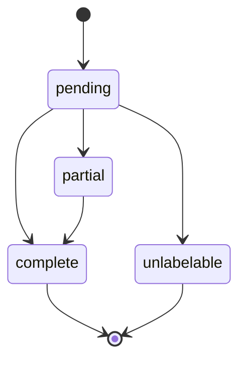

| State | Shown as | Meaning | Notes |
|---|---|---|---|
| `pending` | Pending | No label stored yet: no horizon is due, no price was found for a due horizon, the row has no price anchor, or it is still waiting its turn in the labelling batch. | initial |
| `partial` | Partly labelled | Some horizons labelled; 7 days not yet reached. |  |
| `complete` | Labelled | Seven days passed and at least one label exists. Individual horizons can still be empty. | terminal |
| `unlabelable` | Unlabelable | Seven days passed with no label, or the emission time is unreadable. | terminal |

| From | To | When | Performed by | Guard |
|---|---|---|---|---|
| (new) | `pending` | signal emitted | `scout/outcome_ledger.py::record_emission_with_status` | creation |
| `pending` | `partial` | first horizon labelled | `scout/outcome_ledger.py::label_pending` | check in Python before the write |
| `pending` | `complete` | 7-day horizon reached | `scout/outcome_ledger.py::label_pending` | check in Python before the write |
| `pending` | `unlabelable` | 7-day horizon reached | `scout/outcome_ledger.py::label_pending` | check in Python before the write |
| `partial` | `complete` | 7-day horizon reached | `scout/outcome_ledger.py::label_pending` | check in Python before the write |

## Source-call outcome

`source_call_outcome` · held in `source_calls.outcome_status`

How much of a Telegram/X call's forward performance could be computed. Recomputed for every priceable call on every refresh.

- **State list:** SQLite CHECK constraint
- **Transitions:** declared here only — nothing checks at runtime
- **Checked by tests:** state list compared with the CHECK constraint; transitions not checked (only that each named function exists)

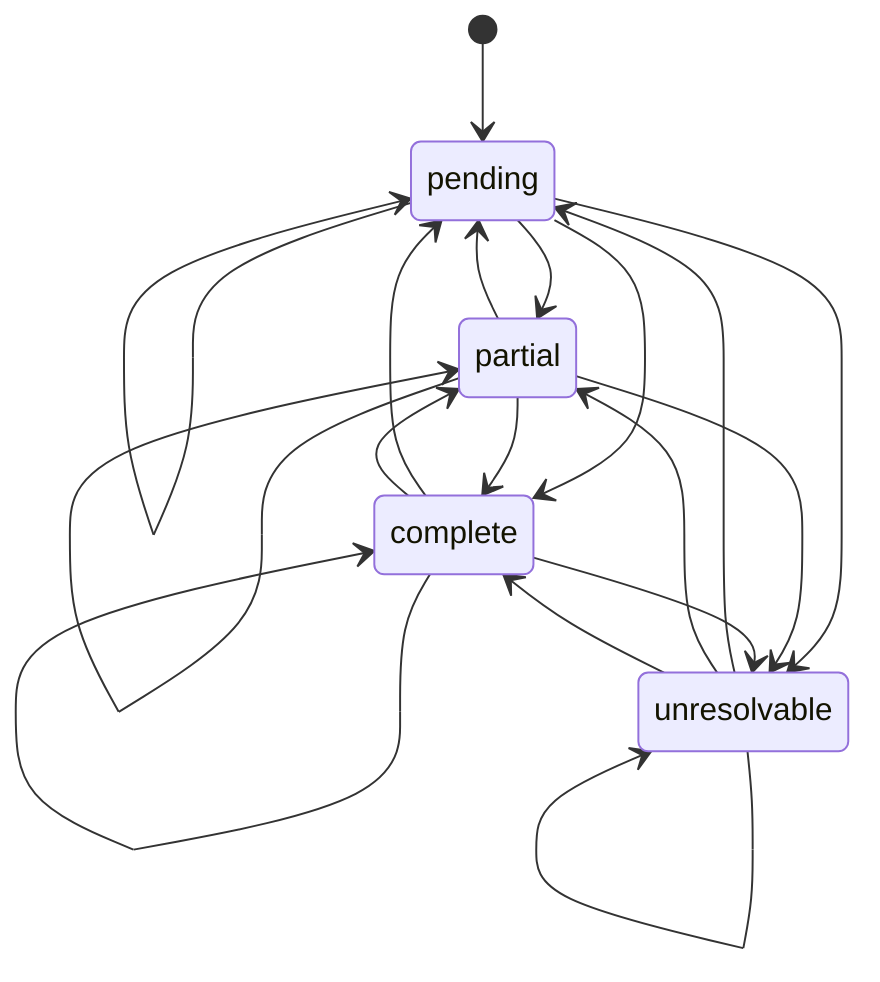

| State | Shown as | Meaning | Notes |
|---|---|---|---|
| `pending` | Pending | At least one forward window has not opened yet (the last opens 24h after the call and closes at 28h); earlier windows may already be computed. Also where a call with no priceable identity stays. | initial |
| `partial` | Partial | Every window has opened and price rows exist, but not every forward field could be computed. |  |
| `complete` | Complete | All forward fields computed. |  |
| `unresolvable` | Unresolvable | No price rows exist for the token. |  |

| From | To | When | Performed by | Guard |
|---|---|---|---|---|
| (new) | `pending` | call ingested | `scout/source_quality/ledger.py::backfill_source_calls` | creation |
| `pending` | `pending` | recomputed from the price data present at refresh time | `scout/source_quality/ledger.py::refresh_source_call_outcomes` | none |
| `pending` | `partial` | recomputed from the price data present at refresh time | `scout/source_quality/ledger.py::refresh_source_call_outcomes` | none |
| `pending` | `complete` | recomputed from the price data present at refresh time | `scout/source_quality/ledger.py::refresh_source_call_outcomes` | none |
| `pending` | `unresolvable` | recomputed from the price data present at refresh time | `scout/source_quality/ledger.py::refresh_source_call_outcomes` | none |
| `partial` | `pending` | recomputed from the price data present at refresh time | `scout/source_quality/ledger.py::refresh_source_call_outcomes` | none |
| `partial` | `partial` | recomputed from the price data present at refresh time | `scout/source_quality/ledger.py::refresh_source_call_outcomes` | none |
| `partial` | `complete` | recomputed from the price data present at refresh time | `scout/source_quality/ledger.py::refresh_source_call_outcomes` | none |
| `partial` | `unresolvable` | recomputed from the price data present at refresh time | `scout/source_quality/ledger.py::refresh_source_call_outcomes` | none |
| `complete` | `pending` | recomputed from the price data present at refresh time | `scout/source_quality/ledger.py::refresh_source_call_outcomes` | none |
| `complete` | `partial` | recomputed from the price data present at refresh time | `scout/source_quality/ledger.py::refresh_source_call_outcomes` | none |
| `complete` | `complete` | recomputed from the price data present at refresh time | `scout/source_quality/ledger.py::refresh_source_call_outcomes` | none |
| `complete` | `unresolvable` | recomputed from the price data present at refresh time | `scout/source_quality/ledger.py::refresh_source_call_outcomes` | none |
| `unresolvable` | `pending` | recomputed from the price data present at refresh time | `scout/source_quality/ledger.py::refresh_source_call_outcomes` | none |
| `unresolvable` | `partial` | recomputed from the price data present at refresh time | `scout/source_quality/ledger.py::refresh_source_call_outcomes` | none |
| `unresolvable` | `complete` | recomputed from the price data present at refresh time | `scout/source_quality/ledger.py::refresh_source_call_outcomes` | none |
| `unresolvable` | `unresolvable` | recomputed from the price data present at refresh time | `scout/source_quality/ledger.py::refresh_source_call_outcomes` | none |

Known hazards (read from the code at registration):

- No state is terminal: the refresh recomputes the status of every priceable call from the price data present at that moment, so a row is not guaranteed to stay complete.
- Calls with no priceable identity, or an unreadable call time, are never recomputed and stay at their insert-time pending.

## Source-call token resolution

`source_call_resolution` · held in `source_calls.resolved_state`

Whether the token a call names was identified. The column carries three vocabularies at once: Telegram's (upper case), X's (lower case) and the refresh's own.

- **State list:** not enforced (string literals at the write sites)
- **Transitions:** declared here only — nothing checks at runtime
- **Checked by tests:** state list not checked against the code; transitions not checked (only that each named function exists)

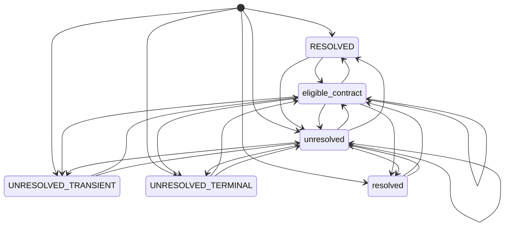

| State | Shown as | Meaning | Notes |
|---|---|---|---|
| `RESOLVED` | Resolved (Telegram) | Copied from the Telegram resolver. | initial |
| `UNRESOLVED_TRANSIENT` | Unresolved, transient (Telegram) | Copied from the Telegram resolver. | initial |
| `UNRESOLVED_TERMINAL` | Unresolved, final (Telegram) | Copied from the Telegram resolver. | initial |
| `resolved` | Resolved (X) | The X call resolved to a coin id. | initial |
| `unresolved` | Unresolved | No token identified at ingest, or (set by the refresh) no priceable identity: neither a CoinGecko coin id nor a contract address. | initial |
| `eligible_contract` | Priceable contract | A contract address that the snapshot writer can price. |  |

| From | To | When | Performed by | Guard |
|---|---|---|---|---|
| (new) | `RESOLVED` | call ingested (value copied from the source) | `scout/source_quality/ledger.py::backfill_source_calls` | creation |
| (new) | `UNRESOLVED_TRANSIENT` | call ingested (value copied from the source) | `scout/source_quality/ledger.py::backfill_source_calls` | creation |
| (new) | `UNRESOLVED_TERMINAL` | call ingested (value copied from the source) | `scout/source_quality/ledger.py::backfill_source_calls` | creation |
| (new) | `resolved` | call ingested (value copied from the source) | `scout/source_quality/ledger.py::backfill_source_calls` | creation |
| (new) | `unresolved` | call ingested (value copied from the source) | `scout/source_quality/ledger.py::backfill_source_calls` | creation |
| `RESOLVED` | `eligible_contract` | refresh reclassifies contract-keyed and identity-less rows | `scout/source_quality/ledger.py::refresh_source_call_outcomes` | none |
| `RESOLVED` | `unresolved` | refresh reclassifies contract-keyed and identity-less rows | `scout/source_quality/ledger.py::refresh_source_call_outcomes` | none |
| `UNRESOLVED_TRANSIENT` | `eligible_contract` | refresh reclassifies contract-keyed and identity-less rows | `scout/source_quality/ledger.py::refresh_source_call_outcomes` | none |
| `UNRESOLVED_TRANSIENT` | `unresolved` | refresh reclassifies contract-keyed and identity-less rows | `scout/source_quality/ledger.py::refresh_source_call_outcomes` | none |
| `UNRESOLVED_TERMINAL` | `eligible_contract` | refresh reclassifies contract-keyed and identity-less rows | `scout/source_quality/ledger.py::refresh_source_call_outcomes` | none |
| `UNRESOLVED_TERMINAL` | `unresolved` | refresh reclassifies contract-keyed and identity-less rows | `scout/source_quality/ledger.py::refresh_source_call_outcomes` | none |
| `resolved` | `eligible_contract` | refresh reclassifies contract-keyed and identity-less rows | `scout/source_quality/ledger.py::refresh_source_call_outcomes` | none |
| `resolved` | `unresolved` | refresh reclassifies contract-keyed and identity-less rows | `scout/source_quality/ledger.py::refresh_source_call_outcomes` | none |
| `unresolved` | `eligible_contract` | refresh reclassifies contract-keyed and identity-less rows | `scout/source_quality/ledger.py::refresh_source_call_outcomes` | none |
| `unresolved` | `unresolved` | refresh reclassifies contract-keyed and identity-less rows | `scout/source_quality/ledger.py::refresh_source_call_outcomes` | none |
| `eligible_contract` | `eligible_contract` | refresh reclassifies contract-keyed and identity-less rows | `scout/source_quality/ledger.py::refresh_source_call_outcomes` | none |
| `eligible_contract` | `unresolved` | refresh reclassifies contract-keyed and identity-less rows | `scout/source_quality/ledger.py::refresh_source_call_outcomes` | none |
| `eligible_contract` | `RESOLVED` | the next backfill overwrites the value from the source again | `scout/source_quality/ledger.py::backfill_source_calls` | none |
| `eligible_contract` | `UNRESOLVED_TRANSIENT` | the next backfill overwrites the value from the source again | `scout/source_quality/ledger.py::backfill_source_calls` | none |
| `eligible_contract` | `UNRESOLVED_TERMINAL` | the next backfill overwrites the value from the source again | `scout/source_quality/ledger.py::backfill_source_calls` | none |
| `eligible_contract` | `resolved` | the next backfill overwrites the value from the source again | `scout/source_quality/ledger.py::backfill_source_calls` | none |
| `eligible_contract` | `unresolved` | the next backfill overwrites the value from the source again | `scout/source_quality/ledger.py::backfill_source_calls` | none |
| `unresolved` | `RESOLVED` | the next backfill overwrites the value from the source again | `scout/source_quality/ledger.py::backfill_source_calls` | none |
| `unresolved` | `UNRESOLVED_TRANSIENT` | the next backfill overwrites the value from the source again | `scout/source_quality/ledger.py::backfill_source_calls` | none |
| `unresolved` | `UNRESOLVED_TERMINAL` | the next backfill overwrites the value from the source again | `scout/source_quality/ledger.py::backfill_source_calls` | none |
| `unresolved` | `resolved` | the next backfill overwrites the value from the source again | `scout/source_quality/ledger.py::backfill_source_calls` | none |
| `unresolved` | `unresolved` | the next backfill overwrites the value from the source again | `scout/source_quality/ledger.py::backfill_source_calls` | none |

Known hazards (read from the code at registration):

- No CHECK constraint. The backfill and the refresh each overwrite the column; the live writer runs them back to back, so between runs a row holds the refresh's answer and during a run it flips.

## Robinhood/Pons curve-launch lifecycle

`curve_launch` · held in `curve_launch_discoveries.lifecycle_status`

Where a launched token is: still on its bonding curve, or graduated to a Uniswap v4 pool. For each token touched by a collection pass it is re-derived from the surviving on-chain evidence.

- **State list:** SQLite CHECK constraint
- **Transitions:** declared here only — nothing checks at runtime
- **Checked by tests:** state list compared with the CHECK constraint; transitions not checked (only that each named function exists)

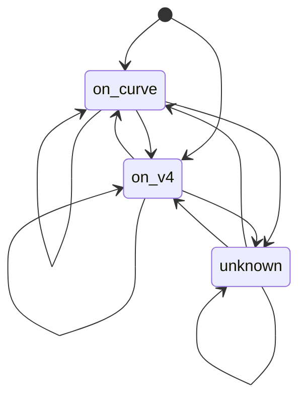

| State | Shown as | Meaning | Notes |
|---|---|---|---|
| `on_curve` | On curve | Trading on its bonding curve. | initial |
| `graduating` | Graduating | Curve swept, pool not yet created. In the vocabulary but no code writes it. | never written by code |
| `on_v4` | On Uniswap v4 | Graduated to a pool. | initial |
| `rescued` | Rescued | Owner-rescued after a failed graduation. In the vocabulary but no code writes it. | never written by code |
| `unknown` | Unknown | No surviving evidence (for example after a chain reorg removed the launch log). Dropped from trade polling. |  |

| From | To | When | Performed by | Guard |
|---|---|---|---|---|
| (new) | `on_curve` | TokenLaunched seen / PoolGraduated seen for an unseen token | `scout/ingestion/rh_pons.py::collect_from_logs` | creation |
| (new) | `on_v4` | TokenLaunched seen / PoolGraduated seen for an unseen token | `scout/ingestion/rh_pons.py::collect_from_logs` | creation |
| `on_curve` | `on_v4` | PoolGraduated for a known token | `scout/ingestion/rh_pons.py::advance_lifecycle` | check in Python before the write |
| `on_curve` | `on_curve` | projection rebuilt from canonical evidence (reorgs can move it back) | `scout/db.py::reconcile_curve_launch_projection` | none |
| `on_curve` | `on_v4` | projection rebuilt from canonical evidence (reorgs can move it back) | `scout/db.py::reconcile_curve_launch_projection` | none |
| `on_curve` | `unknown` | projection rebuilt from canonical evidence (reorgs can move it back) | `scout/db.py::reconcile_curve_launch_projection` | none |
| `on_v4` | `on_curve` | projection rebuilt from canonical evidence (reorgs can move it back) | `scout/db.py::reconcile_curve_launch_projection` | none |
| `on_v4` | `on_v4` | projection rebuilt from canonical evidence (reorgs can move it back) | `scout/db.py::reconcile_curve_launch_projection` | none |
| `on_v4` | `unknown` | projection rebuilt from canonical evidence (reorgs can move it back) | `scout/db.py::reconcile_curve_launch_projection` | none |
| `unknown` | `on_curve` | projection rebuilt from canonical evidence (reorgs can move it back) | `scout/db.py::reconcile_curve_launch_projection` | none |
| `unknown` | `on_v4` | projection rebuilt from canonical evidence (reorgs can move it back) | `scout/db.py::reconcile_curve_launch_projection` | none |
| `unknown` | `unknown` | projection rebuilt from canonical evidence (reorgs can move it back) | `scout/db.py::reconcile_curve_launch_projection` | none |

Known hazards (read from the code at registration):

- advance_lifecycle is forward-only, but the end-of-pass reconcile rewrites the status from evidence without consulting that order, so for a touched token reconcile is the effective source of truth and can move a row backwards.
- graduating and rescued are in the CHECK constraint and the ordering map but no code writes them.

## Telegram message token resolution

`tg_resolution` · held in `tg_social_signals.resolution_state`

Whether a token mentioned in a Telegram message was identified. Rows are insert-only: a successful retry adds a second row instead of updating the first.

- **State list:** Python Enum
- **Transitions:** declared here only — nothing checks at runtime
- **Checked by tests:** state list compared with the ResolutionState Enum; transitions not checked (only that each named function exists)

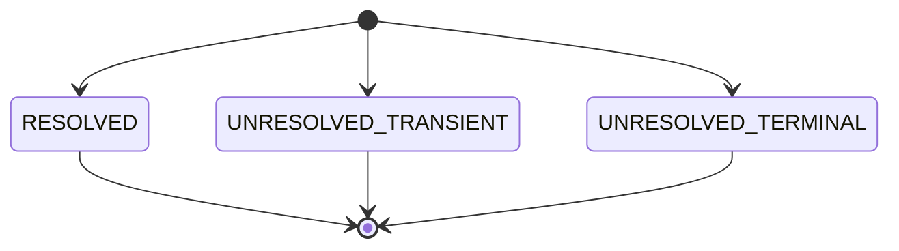

| State | Shown as | Meaning | Notes |
|---|---|---|---|
| `RESOLVED` | Resolved | Token identified. For a cashtag-only message that is the top search candidate, with no contract address. | initial, terminal |
| `UNRESOLVED_TRANSIENT` | Unresolved — retry was scheduled | Not found on the first attempt and one in-memory retry was scheduled. The row never changes, so it cannot tell a pending retry from one that failed or was lost. | initial, terminal |
| `UNRESOLVED_TERMINAL` | Unresolved — final | Not found on the first attempt and the miss is not retryable. Alert only, no trade. A failed retry writes no row. | initial, terminal |

| From | To | When | Performed by | Guard |
|---|---|---|---|---|
| (new) | `RESOLVED` | message resolved (first attempt, or a successful retry) | `scout/social/telegram/listener.py::_replay_post_resolution` | creation |
| (new) | `UNRESOLVED_TRANSIENT` | message resolved (first attempt, or a successful retry) | `scout/social/telegram/listener.py::_replay_post_resolution` | creation |
| (new) | `UNRESOLVED_TERMINAL` | message resolved (first attempt, or a successful retry) | `scout/social/telegram/listener.py::_replay_post_resolution` | creation |

Known hazards (read from the code at registration):

- The column has no CHECK. The Enum in scout/social/telegram/models.py is the Python spelling; SQL readers in scout/social/telegram/shadow.py, dashboard/db.py and scripts/check_tg_shadow_lag.py compare against the raw string 'RESOLVED'.
- A transient row is never updated: a successful retry inserts a second row, a failed retry writes nothing, and the retry itself is an in-memory task that does not survive a restart.

## Telegram listener health

`tg_listener` · held in `tg_social_health.listener_state`

Last recorded health of the Telegram listener. The same column is also written, always as 'running', by per-channel and shadow-scan heartbeat rows, so a count of 'running' rows says nothing about the listener itself.

- **State list:** constants in one module
- **Transitions:** declared here only — nothing checks at runtime
- **Checked by tests:** state list compared with the ListenerState Literal; transitions not checked (only that each named function exists)

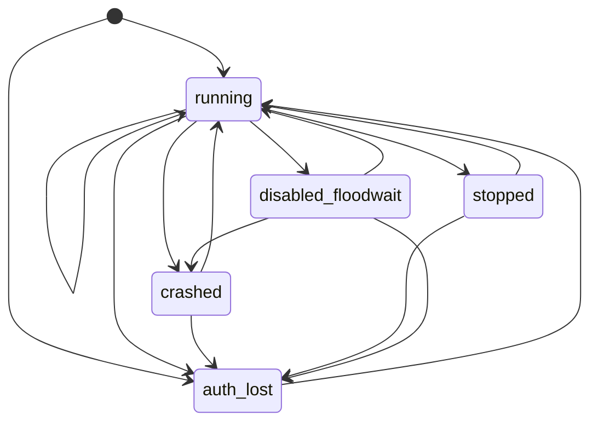

| State | Shown as | Meaning | Notes |
|---|---|---|---|
| `running` | Running | The listener connected and verified its session. Also what the row still says after a normal shutdown or a hard kill. | initial |
| `auth_lost` | Could not connect / not authorised | The session was revoked, or connecting at start failed for any reason (every start-up connect failure is recorded this way). | initial, needs attention |
| `crashed` | Crashed | The listener task died with an exception. | needs attention |
| `stopped` | Disconnected | The Telegram connection ended on its own. A normal pipeline shutdown does not write this. |  |
| `disabled_floodwait` | Disabled — flood wait | Telegram rate-limited the account past the circuit-breaker threshold. | needs attention |

| From | To | When | Performed by | Guard |
|---|---|---|---|---|
| (new) | `running` | first start: session verified / connect failed | `scout/social/telegram/listener.py::_set_listener_state` | creation |
| (new) | `auth_lost` | first start: session verified / connect failed | `scout/social/telegram/listener.py::_set_listener_state` | creation |
| (new) | `running` | per-channel heartbeat row | `scout/social/telegram/listener.py::_persist_message_with_watermark` | creation |
| (new) | `running` | shadow-scan heartbeat row | `scout/social/telegram/shadow.py::_upsert_health_row` | creation |
| `running` | `running` | listener (re)started and verified its session | `scout/social/telegram/listener.py::_set_listener_state` | none |
| `auth_lost` | `running` | listener (re)started and verified its session | `scout/social/telegram/listener.py::_set_listener_state` | none |
| `crashed` | `running` | listener (re)started and verified its session | `scout/social/telegram/listener.py::_set_listener_state` | none |
| `stopped` | `running` | listener (re)started and verified its session | `scout/social/telegram/listener.py::_set_listener_state` | none |
| `disabled_floodwait` | `running` | listener (re)started and verified its session | `scout/social/telegram/listener.py::_set_listener_state` | none |
| `running` | `auth_lost` | session revoked while running, or connect failed at restart | `scout/social/telegram/listener.py::_set_listener_state` | none |
| `crashed` | `auth_lost` | session revoked while running, or connect failed at restart | `scout/social/telegram/listener.py::_set_listener_state` | none |
| `stopped` | `auth_lost` | session revoked while running, or connect failed at restart | `scout/social/telegram/listener.py::_set_listener_state` | none |
| `disabled_floodwait` | `auth_lost` | session revoked while running, or connect failed at restart | `scout/social/telegram/listener.py::_set_listener_state` | none |
| `running` | `crashed` | exception / connection ended on its own / flood wait | `scout/social/telegram/listener.py::_set_listener_state` | none |
| `running` | `stopped` | exception / connection ended on its own / flood wait | `scout/social/telegram/listener.py::_set_listener_state` | none |
| `running` | `disabled_floodwait` | exception / connection ended on its own / flood wait | `scout/social/telegram/listener.py::_set_listener_state` | none |
| `disabled_floodwait` | `crashed` | a start-up flood wait re-raises and is then recorded as a crash | `scout/social/telegram/listener.py::_set_listener_state` | none |

Known hazards (read from the code at registration):

- Writes are unconditional upserts. A normal shutdown cancels the task without writing, and a hard kill writes nothing either, so both leave the row at running with nothing to age it out.
- ListenerState in scout/social/telegram/listener.py includes crashed; the copy in scout/social/telegram/models.py does not.

## Telegram channel subscription

`tg_channel` · held in `tg_social_channels.removed_at`

Whether a curated Telegram channel is meant to be listened to.

- **State list:** derived from several columns (no stored state name)
- **Transitions:** declared here only — nothing checks at runtime
- **Checked by tests:** state list not checked against the code; transitions not checked (only that each named function exists)

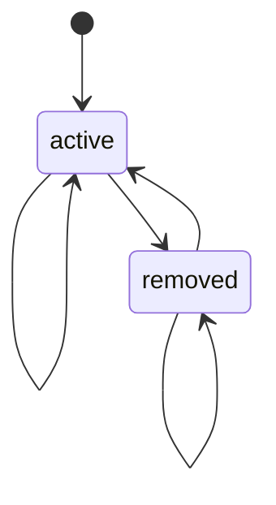

| State | Shown as | Meaning | Notes |
|---|---|---|---|
| `active` | Active | Should be listened to. The listener picks changes up at its next channel reload (or restart, if reloading is off). | initial |
| `removed` | Removed | Should be ignored: removed by the operator, or automatically after the account lost access. Takes effect at the next reload. |  |

| From | To | When | Performed by | Guard |
|---|---|---|---|---|
| (new) | `active` | operator adds | `scout/social/telegram/cli.py::cmd_add` | creation |
| (new) | `active` | channels.yml sync adds a new channel | `scout/social/telegram/cli.py::cmd_sync_channels` | creation |
| `active` | `active` | operator re-adds an active channel (the row is replaced) | `scout/social/telegram/cli.py::cmd_add` | none |
| `active` | `removed` | operator removes | `scout/social/telegram/cli.py::cmd_remove` | compare-and-swap in SQL |
| `active` | `removed` | channel access lost | `scout/social/telegram/listener.py::_mark_channel_removed_and_alert` | none |
| `removed` | `removed` | access lost again (removed_at is re-stamped) | `scout/social/telegram/listener.py::_mark_channel_removed_and_alert` | none |
| `removed` | `active` | channels.yml sync lists it again | `scout/social/telegram/cli.py::cmd_sync_channels` | none |
| `removed` | `active` | operator re-adds | `scout/social/telegram/cli.py::cmd_add` | none |

How each state is recognised in the table:

- `active`: `removed_at IS NULL`
- `removed`: `removed_at IS NOT NULL`

Known hazards (read from the code at registration):

- cmd_add uses INSERT OR REPLACE, which resets columns it does not set (such as cashtag_trade_eligible) and changes the row id.
- A sync reactivates channels the listener removed for lost access.

## Narrative prediction evaluation

`prediction_outcome` · held in `predictions.outcome_class`

A narrative prediction is checked at 6, 24 and 48 hours; the final class is the result of the first evaluation at or after 48 hours.

- **State list:** not enforced (string literals at the write sites)
- **Transitions:** guarded — writes check the prior state
- **Checked by tests:** state list not checked against the code; transitions not checked (only that each named function exists)
- **NULL means:** `pending`

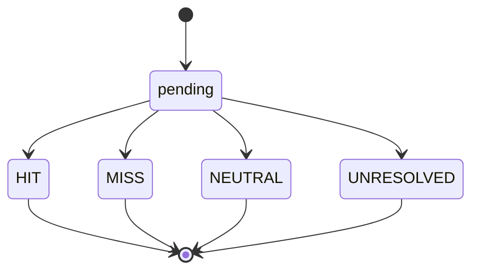

| State | Shown as | Meaning | Notes |
|---|---|---|---|
| `pending` | Pending | Not finally evaluated (stored as NULL). The 6h and 24h checkpoints fill in first. | initial |
| `HIT` | Hit | Up by at least the hit threshold at the 48h evaluation. | terminal |
| `MISS` | Miss | Down by at least the miss threshold at the 48h evaluation. | terminal |
| `NEUTRAL` | Neutral | Between the thresholds at the 48h evaluation. | terminal |
| `UNRESOLVED` | Unresolved | Three evaluation passes found no price. | terminal |

| From | To | When | Performed by | Guard |
|---|---|---|---|---|
| (new) | `pending` | prediction stored | `scout/narrative/predictor.py::store_predictions` | creation |
| `pending` | `HIT` | first evaluation at or after 48h / third pass without a price | `scout/narrative/evaluator.py::evaluate_pending` | check in Python before the write |
| `pending` | `MISS` | first evaluation at or after 48h / third pass without a price | `scout/narrative/evaluator.py::evaluate_pending` | check in Python before the write |
| `pending` | `NEUTRAL` | first evaluation at or after 48h / third pass without a price | `scout/narrative/evaluator.py::evaluate_pending` | check in Python before the write |
| `pending` | `UNRESOLVED` | first evaluation at or after 48h / third pass without a price | `scout/narrative/evaluator.py::evaluate_pending` | check in Python before the write |

Known hazards (read from the code at registration):

- eval_retry_count is cumulative and is also incremented when the price is missing because of the call budget, a rate limit or a network error, so UNRESOLVED can be written before 48 hours and without a real price failure.
- A prediction whose price_at_prediction is zero or negative is skipped on every pass and stays pending.
- scout/chains/tracker.py reads this column and treats NEUTRAL as a miss.

## Chain-match outcome

`chain_match_outcome` · held in `chain_matches.outcome_class`

Whether a completed (or expired) signal chain was followed by a real move.

- **State list:** not enforced (string literals at the write sites)
- **Transitions:** guarded — writes check the prior state
- **Checked by tests:** state list not checked against the code; transitions not checked (only that each named function exists)
- **NULL means:** `pending`

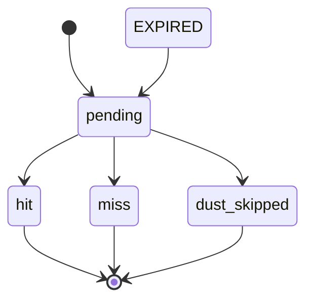

| State | Shown as | Meaning | Notes |
|---|---|---|---|
| `pending` | Pending | Not evaluated (stored as NULL). Evaluation is attempted from 48 hours after completion; the row stays pending for as long as no outcome source is available. | initial |
| `hit` | Hit | Judged a hit: for a narrative chain the coin's latest resolved prediction was a hit; for a memecoin chain its current FDV is at least the configured percentage above the market cap stored at completion (or, when none was stored, its latest recorded price change is positive). | terminal |
| `miss` | Miss | Judged not a hit. | terminal |
| `dust_skipped` | Skipped — dust | Market cap too small to evaluate. | terminal |
| `EXPIRED` | Expired (legacy) | Legacy value that no code writes any more; a migration resets it to pending for narrative rows. | never written by code |

| From | To | When | Performed by | Guard |
|---|---|---|---|---|
| (new) | `pending` | chain completed | `scout/chains/tracker.py::_record_completion` | creation |
| (new) | `pending` | chain expired | `scout/chains/tracker.py::_record_expired_chain` | creation |
| `pending` | `hit` | evaluated, 48 hours or more after completion | `scout/chains/tracker.py::_update_chain_outcomes_inner` | check in Python before the write |
| `pending` | `miss` | evaluated, 48 hours or more after completion | `scout/chains/tracker.py::_update_chain_outcomes_inner` | check in Python before the write |
| `pending` | `dust_skipped` | evaluated, 48 hours or more after completion | `scout/chains/tracker.py::_update_chain_outcomes_inner` | check in Python before the write |
| `EXPIRED` | `pending` | migration resets legacy narrative rows | `scout/db.py::_migrate_feedback_loop_schema` | compare-and-swap in SQL |

Known hazards (read from the code at registration):

- An expired chain and a completed chain write the same kind of row; they can only be told apart by conviction_boost = 0 and the step count, and both put the token and pattern into cooldown.

## Narrative alert resolution

`narrative_resolution` · held in `narrative_alerts_inbound.resolution_status`

Whether an inbound narrative alert carried a contract that resolved to a coin.

- **State list:** not enforced (string literals at the write sites)
- **Transitions:** guarded — writes check the prior state
- **Checked by tests:** state list not checked against the code; transitions not checked (only that each named function exists)
- **NULL means:** `unclassified`

```mermaid
stateDiagram-v2
    [*] --> cashtag_only
    [*] --> ca_resolved
    [*] --> ca_unresolved
    unclassified --> cashtag_only
    unclassified --> ca_resolved
    unclassified --> ca_unresolved
    ca_unresolved --> ca_resolved
    cashtag_only --> [*]
    ca_resolved --> [*]
```

| State | Shown as | Meaning | Notes |
|---|---|---|---|
| `unclassified` | Unclassified | Stored before the column existed (NULL); classified the next time the database is initialised. | never written by code |
| `cashtag_only` | Cashtag only | No contract address in the alert; nothing to resolve. | initial, terminal |
| `ca_resolved` | Contract resolved | The contract mapped to a coin. | initial, terminal |
| `ca_unresolved` | Contract unresolved | A contract was present but no coin was found. Retried every time the database is initialised. | initial |

| From | To | When | Performed by | Guard |
|---|---|---|---|---|
| (new) | `cashtag_only` | alert received | `scout/api/narrative_resolver.py::insert_narrative_alert` | creation |
| (new) | `ca_resolved` | alert received | `scout/api/narrative_resolver.py::insert_narrative_alert` | creation |
| (new) | `ca_unresolved` | alert received | `scout/api/narrative_resolver.py::insert_narrative_alert` | creation |
| `unclassified` | `cashtag_only` | backfill on database initialisation | `scout/db.py::_migrate_narrative_resolution_status_v1` | compare-and-swap in SQL |
| `unclassified` | `ca_resolved` | backfill on database initialisation | `scout/db.py::_migrate_narrative_resolution_status_v1` | compare-and-swap in SQL |
| `unclassified` | `ca_unresolved` | backfill on database initialisation | `scout/db.py::_migrate_narrative_resolution_status_v1` | compare-and-swap in SQL |
| `ca_unresolved` | `ca_resolved` | retro-resolve on database initialisation found the coin | `scout/db.py::_migrate_narrative_resolution_status_v1` | compare-and-swap in SQL |

Known hazards (read from the code at registration):

- The backfill and retro-resolve are not gated: they run on every Database.initialize(), which includes the pipeline, the dashboard and CLI commands.

## Ingestion source starvation watchdog

`ingest_source` · held in `scout.heartbeat._ingest_watchdog_state[source] (+ ingest_watchdog_state)`

Per data source: is it returning rows? One page is attempted when a source has been empty for the configured number of cycles.

- **State list:** not enforced (string literals at the write sites)
- **Transitions:** guarded — writes check the prior state
- **Checked by tests:** state list not checked against the code; transitions not checked (only that each named function exists)

```mermaid
stateDiagram-v2
    [*] --> healthy
    [*] --> counting
    [*] --> starved
    healthy --> counting
    healthy --> starved
    counting --> starved
    counting --> healthy
    starved --> healthy
```

| State | Shown as | Meaning | Notes |
|---|---|---|---|
| `healthy` | Healthy | Returned rows on the last cycle. | initial |
| `counting` | Empty, below threshold | Empty for fewer cycles than the threshold. | initial |
| `starved` | Starved | Empty for the threshold number of cycles. A page was attempted once for this episode; it is not retried if it failed, not sent in dry-run, and not re-sent after a restart. | initial, needs attention |

| From | To | When | Performed by | Guard |
|---|---|---|---|---|
| (new) | `healthy` | boot: restored from the persisted miss counter | `scout/heartbeat.py::hydrate_ingest_watchdog_state` | creation |
| (new) | `counting` | boot: restored from the persisted miss counter | `scout/heartbeat.py::hydrate_ingest_watchdog_state` | creation |
| (new) | `starved` | boot: restored from the persisted miss counter | `scout/heartbeat.py::hydrate_ingest_watchdog_state` | creation |
| (new) | `healthy` | source first observed (empty counts at once; starved if threshold is 1) | `scout/heartbeat.py::observe_ingest_sources` | creation |
| (new) | `counting` | source first observed (empty counts at once; starved if threshold is 1) | `scout/heartbeat.py::observe_ingest_sources` | creation |
| (new) | `starved` | source first observed (empty counts at once; starved if threshold is 1) | `scout/heartbeat.py::observe_ingest_sources` | creation |
| `healthy` | `counting` | a cycle returned nothing | `scout/heartbeat.py::observe_ingest_sources` | check in Python before the write |
| `healthy` | `starved` | a cycle returned nothing | `scout/heartbeat.py::observe_ingest_sources` | check in Python before the write |
| `counting` | `starved` | empty cycles reached the threshold | `scout/heartbeat.py::observe_ingest_sources` | check in Python before the write |
| `counting` | `healthy` | rows returned again | `scout/heartbeat.py::observe_ingest_sources` | check in Python before the write |
| `starved` | `healthy` | rows returned again | `scout/heartbeat.py::observe_ingest_sources` | check in Python before the write |

Known hazards (read from the code at registration):

- The source is marked alerted before the Telegram page is sent, so a failed page is not retried during that outage.
- The persisted table means three different things depending on the source key: a miss counter, a poll heartbeat (dex_discovery, rh_pons) or a failure streak (rh_pons_attempt).
